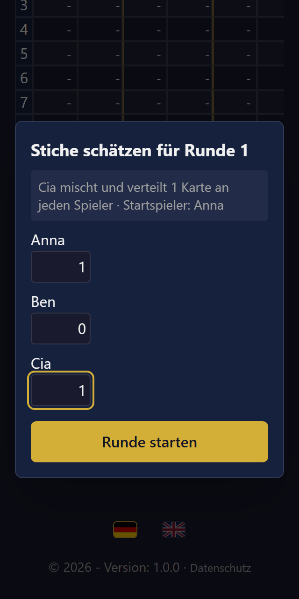
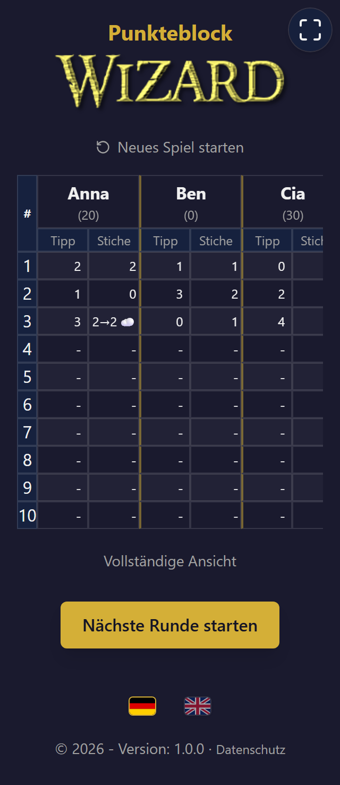

# Wizard Scoreboard

A digital scoreboard for the card game Wizard, built with Vite, React, and TypeScript.


<table>
  <tr>
    <td></td>
    <td></td>
  </tr>
  <tr>
    <td></td>
    <td></td>
  </tr>
</table>

You can see a live demo [here](https://bj-eberhardt.github.io/wizard-scorecard/).

## Features

- Easy management of players and rounds
- Clear display of scores
- Responsive design for desktop and mobile

## Development

```bash
npm install
npm run dev
```

## E2E-Tests

Die E2E-Suite läuft mit [Playwright](https://playwright.dev) gegen den Produktions-Build
(`vite preview`, Port 4173) in zwei Projekten: `chromium-desktop` und `chromium-mobile`
(Pixel 7). Tests, die mit `@mobile` markiert sind, laufen ausschließlich im Mobile-Projekt,
sodaß jeder Test genau einmal ausgeführt wird.

```bash
npm run test:e2e          # komplette Suite (buildet und startet den Preview-Server selbst)
npm run test:e2e:ui       # interaktive Playwright-UI (auswählen, einzeln ausführen, Watch)
npm run test:e2e:headed   # sichtbar im Browser
npm run test:e2e:report   # HTML-Report öffnen
```

Lokales Ausführen in der UI: `npm run test:e2e:ui` öffnet den grafischen Playwright-Test-Runner.
Dort lassen sich einzelne Specs/Tests per Klick starten, im Watch-Modus bei Codeänderungen
automatisch erneut ausführen und über Time-Travel (Screenshots, DOM, Netzwerk, Console) pro
Schritt debuggen. Der Preview-Server wird dabei wie bei `test:e2e` automatisch gestartet.

Konventionen:

- **`?e2e=1`**: Beim Testen wird die App unter `/?e2e=1` geöffnet. Das Flag neutralisiert die
  2s-Splash- und die 2s-Submit-Sperre, um die Laufzeit kurz zu halten. Ohne Flag ist das
  Verhalten identisch zur Produktion; die Submit-Sperre wird in einem dedizierten Test ohne
  Flag geprüft.
- **Selektoren**: Es wird stets über `data-testid` selektiert (Single Source of Truth in
  [`src/test-ids.ts`](src/test-ids.ts)), nie über sichtbare Texte oder CSS-Klassen.
- **Lokalisierungssicherheit**: Fehlermeldungen, Sieger und die Submit-Sperre werden als
  `data-*`-Attribute exponiert (z. B. `data-error-key`, `data-winner-count`,
  `data-submit-ready`). Tests asserten gegen diese Attribute statt gegen Strings und sind so
  unabhängig von der eingestellten Sprache.
- **State-Seedings**: Fortgeschrittene Spielzustände werden per injiziertem `localStorage`
  geseedet statt durch Anklicken vieler Runden (`seedGameState` in
  [`e2e/fixtures.ts`](e2e/fixtures.ts)).

Die Suite läuft automatisch in der CI (`.github/workflows/e2e.yml` bei Push/PR auf `master`).

## Production & Deployment

### Docker

The project can be built with Docker and served using nginx:

```bash
docker build -t wizard-scoreboard .
docker run -p 8080:80 wizard-scoreboard
```

It starts at `http://localhost:8080`.

You can get the image also via docker-hub via:
https://hub.docker.com/repository/docker/beberhardt/wizard-scorecard

### Webassets folder

You can also create the assets directly and serve them yourself on any web server:

```bash
npm run build
```
will build the assets in the folder "dist". You can also download the latest assets from the [releases](https://github.com/bj-eberhardt/wizard-scorecard/releases) page.