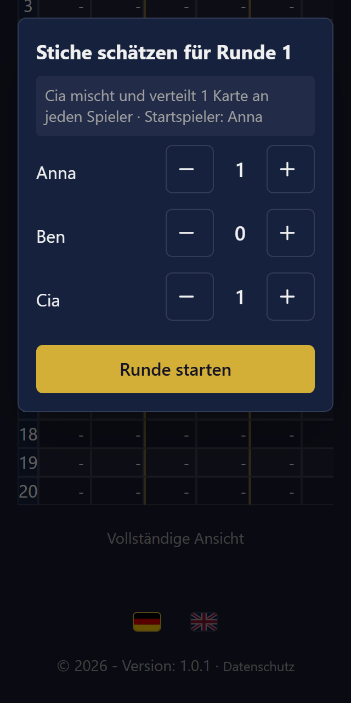
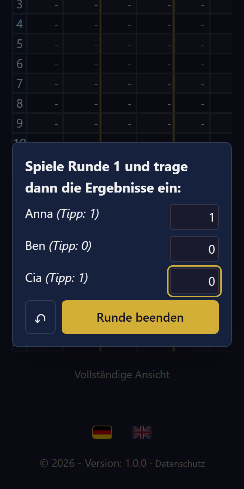
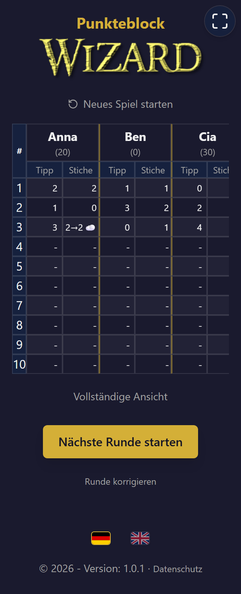
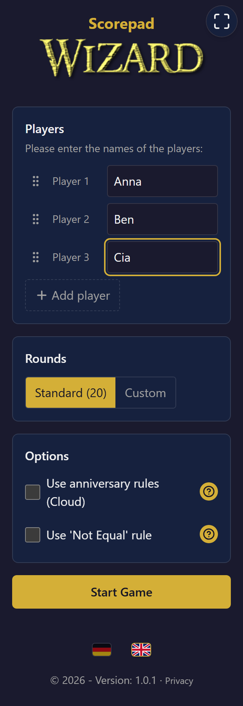
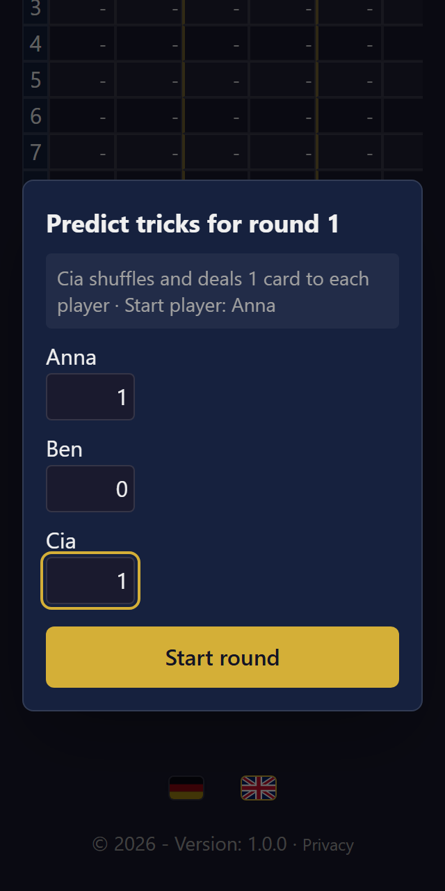
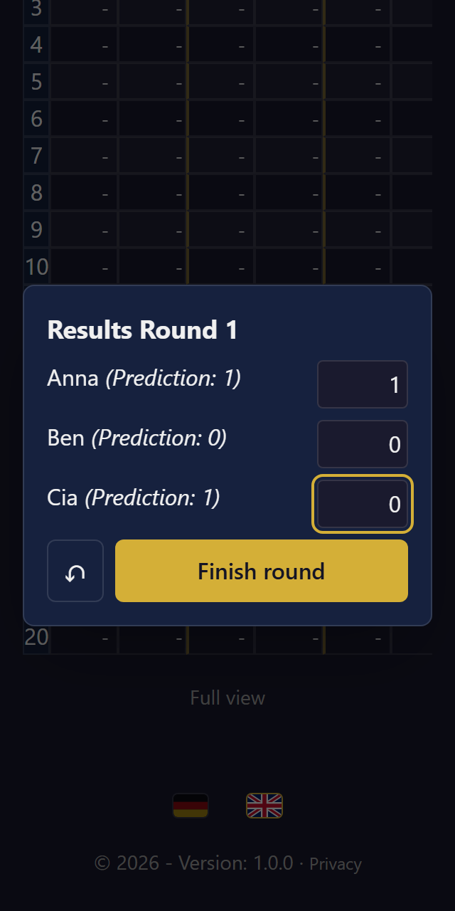
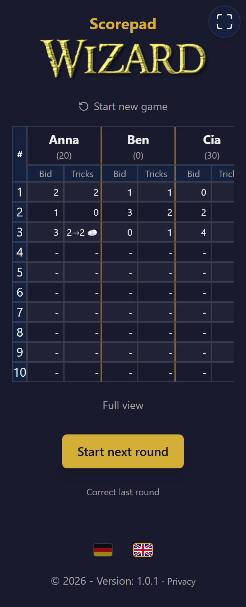

# Wizard Scoreboard


 Deutsch ·
 <a href="#english">English</a>

Digitale Punktetafel für das Kartenspiel **Wizard** – gebaut mit Vite, React und TypeScript.
Gedacht für den gemeinsamen Gebrauch am Tisch: ein Handy, schnelle Eingabe, aus der Entfernung lesbar.

<table>
  <tr>
    <td></td>
    <td></td>
  </tr>
  <tr>
    <td></td>
    <td></td>
  </tr>
</table>

## Ausprobieren

- Live-Demo: [bj-eberhardt.github.io/wizard-scorecard](https://bj-eberhardt.github.io/wizard-scorecard/)
- Android-App im Google Play Store (Paket `de.emailspeicher.wizardpunkteblock`):

<a href="https://play.google.com/store/apps/details?id=de.emailspeicher.wizardpunkteblock" rel="noopener">
  
</a>

## Funktionen

- Einfache Verwaltung von Spielern und Runden
- Klare Anzeige der Punktestände
- Responsives Design für Desktop und Mobil

## Entwicklung

Lokales Setup (`npm run dev`), Produktions-Build, die Playwright-E2E-Suite und das Aktualisieren
der Screenshots oben sind in [DEV.md](DEV.md) dokumentiert.

## Produktion & Deployment

### Docker

Das Projekt lässt sich mit Docker bauen und über nginx ausliefern:

```bash
docker build -t wizard-scoreboard .
docker run -p 8080:80 wizard-scoreboard
```

Danach läuft die App unter `http://localhost:8080`.

Das fertige Image gibt es auch auf Docker Hub:
https://hub.docker.com/repository/docker/beberhardt/wizard-scorecard

### Webassets-Ordner

Wer die App ohne eigene Build-Umgebung selbst hosten will, lädt das Release-ZIP (`dist.zip`) von der
[Releases-Seite](https://github.com/bj-eberhardt/wizard-scorecard/releases) herunter. Es enthält den
fertigen Produktions-Build: Nach dem Entpacken liegen `index.html` und die zugehörigen Assets
direkt beieinander, ohne Zwischenordner. Diesen Inhalt auf einen beliebigen Webserver legen – nginx,
Apache, GitHub Pages oder ein statisches Verzeichnis – und `index.html` als Startseite ausliefern.

**Pfad beachten:** Das ZIP wird von der CI für GitHub Pages gebaut, die Asset-Pfade tragen dort das
Präfix `/wizard-scorecard/`. Es läuft daher genau unter diesem Pfad, also
`https://<domain>/wizard-scorecard/`. Wer die App auf der Wurzel oder einem anderen Unterpfad
hosten möchte, nimmt stattdessen das Docker-Image (relative Pfade, läuft überall) oder baut den
Ordner selbst – siehe [DEV.md](DEV.md).

---

## English

**Deutsch:** die deutsche Version steht oben, [↑ zum Anfang](#wizard-scoreboard).

A digital scoreboard for the card game **Wizard**, built with Vite, React, and TypeScript. Designed
for one shared phone at the game table: fast input, readable from a distance.

The four mobile screenshots below show the configuration, the prediction overlay, the result
overlay and the scoreboard in English.

<table>
  <tr>
    <td></td>
    <td></td>
  </tr>
  <tr>
    <td></td>
    <td></td>
  </tr>
</table>

### Try it out

- Live demo: [bj-eberhardt.github.io/wizard-scorecard](https://bj-eberhardt.github.io/wizard-scorecard/)
- Android app on Google Play (package `de.emailspeicher.wizardpunkteblock`):

<a href="https://play.google.com/store/apps/details?id=de.emailspeicher.wizardpunkteblock" rel="noopener">
  
</a>

### Features

- Easy management of players and rounds
- Clear display of scores
- Responsive design for desktop and mobile

### Development

Local setup (`npm run dev`), the production build, the Playwright E2E suite and how to refresh the
screenshots above are documented in [DEV.md](DEV.md).

### Production & deployment

#### Docker

The project can be built with Docker and served using nginx:

```bash
docker build -t wizard-scoreboard .
docker run -p 8080:80 wizard-scoreboard
```

It starts at `http://localhost:8080`.

You can get the image also via docker-hub via:
https://hub.docker.com/repository/docker/beberhardt/wizard-scorecard

#### Webassets folder

To host the app without your own build environment, download the release ZIP (`dist.zip`) from the
[releases page](https://github.com/bj-eberhardt/wizard-scorecard/releases). It contains the finished
production build: once unzipped, `index.html` and its assets sit side by side, with no intermediate
folder. Put that content on any web server – nginx, Apache, GitHub Pages or a plain static
directory – and serve `index.html` as the entry point.

**Path caveat:** the ZIP is built by CI for GitHub Pages, so its asset references carry the
`/wizard-scorecard/` prefix. It therefore works when hosted at exactly that path,
`https://<domain>/wizard-scorecard/`. To host at the root or under a different sub-path, use the
Docker image instead (relative paths, works anywhere) or build the bundle yourself – see
[DEV.md](DEV.md).
